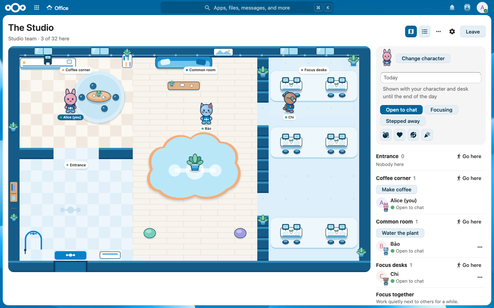
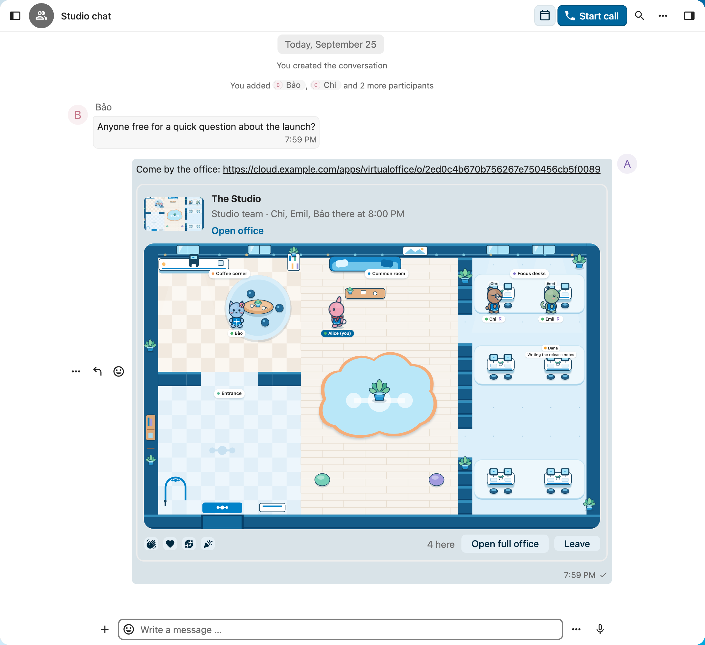

<!--
  - SPDX-FileCopyrightText: 2026 Hoang Pham
  - SPDX-License-Identifier: AGPL-3.0-or-later
-->

<h1 align="center">Virtual Office</h1>

<strong>See who's around. Drop by.</strong> A small shared office for Nextcloud Teams, groups and Talk conversations.

<a href="https://apps.nextcloud.com/apps/virtualoffice">Install from the App Store</a> · <a href="https://hweihwang.com/virtualoffice/">Website</a> · <a href="https://hweihwang.com/virtualoffice/#film">Watch the film</a> · <a href="docs/admin.md">Admin guide</a> · <a href="CHANGELOG.md">Changelog</a> Free and open source for Nextcloud 35.

Remote teams lose the small moments: seeing that someone is around, asking a quick question, having a coffee together. Virtual Office gives a Team, a group or a Talk conversation a small shared office, so you can see who is there, step in as a character and say hi before anyone has to start a call.

## What you can do

- **Knock first.** Ask "got 2 minutes?"; they answer **Now**, **In 10 minutes** or **Later**.
- **Use it inside Talk.** Open a conversation's office from any message menu and step in without leaving the chat.
- **Talk to who's close.** Turn on your mic and the people next to you hear you, louder the closer they stand. Hold **V** to talk, or use an open mic.
- **Share the room.** Make a coffee together, play music from your Files on the record player, keep a desk with a note for the day, or focus together for 25 or 50 minutes.
- **Work across time zones.** See each person's local time and the hours you all share today.
- **Find it where you work.** Offices show up on the Dashboard, in search, in the Smart Picker and on Team pages.

## Privacy

Opening an office never makes you visible; you choose **Enter office**. Only members of the Team, group or conversation can find and enter it. Virtual Office keeps no history of visits or movement. Voice goes directly between browsers and is never recorded. The [admin guide](docs/admin.md#privacy) lists what is stored and when it is removed.

## Requirements

- Nextcloud 35. No extra server is needed.
- Optional: Talk for conversation offices and calls (tested with Talk 25), Teams for Team offices, Deck for due cards on Team boards, and Client Push (notify_push) for instant movement. Without Client Push, browsers check for changes about once a second.
- Voice needs HTTPS and uses the STUN and TURN servers set up in Talk. Company networks often need a TURN server.

## Getting started

1. Install Virtual Office from the [Nextcloud App Store](https://apps.nextcloud.com/apps/virtualoffice), then open **Office** from the app menu.
2. Create an office for one of your Teams, or open one from a Talk conversation. Admins can also create group offices and an office for everyone.
3. Pick your character and select **Enter office**. Click or tap to walk, or use the arrow keys or W A S D. Select **Leave** when you are done.

The people and places list does everything the map does and works with screen readers.

## Development

~~~sh
npm ci && composer install
npm run build                 # frontend into js/
tests/fixture/setup.sh push   # Nextcloud 35, PostgreSQL, Talk and Client Push on http://localhost:18935
~~~

| Check | Command |
|---|---|
| PHP unit tests, static analysis, code style | `composer test:unit`, `composer psalm`, `composer cs:check` |
| JS unit tests, types, lint | `npm run test:unit`, `npm run typecheck`, `npm run lint` |
| API and browser end-to-end | `npm run test:e2e`; `VO_TRANSPORT=polling` after `tests/fixture/setup.sh polling`; voice through TURN alone with `VO_TURN=1` after `tests/fixture/setup.sh push turn` |
| Load | `npm run test:load -- --people 32 --seconds 60 --mode push` |
| Screenshots, social preview, product page assets | `scripts/marketing/build.sh` |
| Film | `node scripts/marketing/film/render.mjs` |
| Release archive | `npm run package` (unsigned), `scripts/sign-release.sh ~/.nextcloud/certificates` (signed) |

[docs/architecture.md](docs/architecture.md) explains how it works and why. [docs/releasing.md](docs/releasing.md) describes a release.

## License

AGPL-3.0-or-later. Bundled libraries keep their own licenses, listed next to each file in `js/*.license`, with texts in `LICENSES/`. The logo, icons and office scene are original SVG artwork. The fonts in `scripts/marketing/film/fonts/` are under the SIL Open Font License and only render the marketing assets. The screenshots show test accounts on a test instance.

Virtual Office is a community app. It is not made or endorsed by Nextcloud GmbH.
